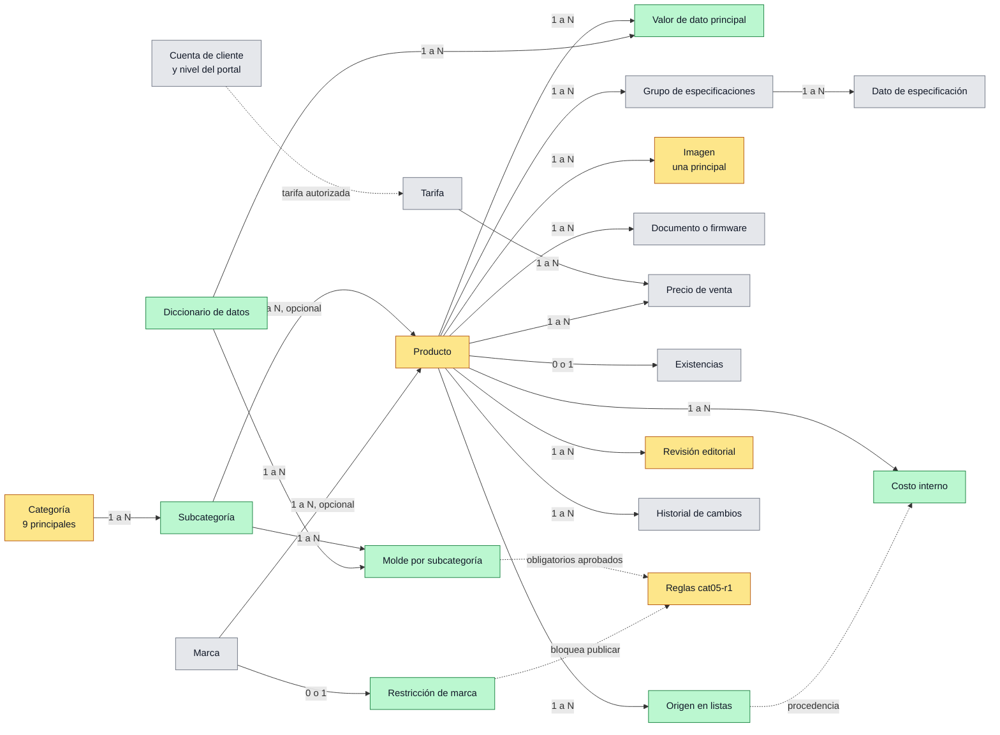
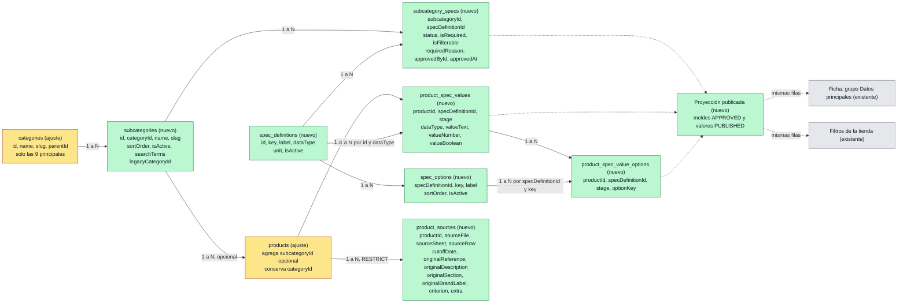

# Estructura funcional y de datos de la Biblioteca

Versión consolidada: 29/10/2026. Incluye las correcciones del usuario a la propuesta inicial y está pendiente de aprobación.

En esta etapa no se modifica código, base de datos, servidores ni archivos de origen. No incluye importadores, scraping ni cargas masivas.

## Fuentes

| Fuente | Qué aporta |
|---|---|
| Ficha pública del demo iDS-E04HQHI-D (HTML guardado) y `src/frontend/src/features/products/data/ids-e04hqhi-d.json` | Presentación: qué ve el cliente y en qué orden |
| `LISTAS_CONSOLIDADAS_POR_MARCA_Y_PROVEEDOR.xlsx` (corte 28/10/2026) | Datos de partida: 39 archivos, 5.357 registros y 41 hojas de marca o proveedor, con referencia, descripción, sección, 5 tarifas, costo, origen (archivo, hoja y fila), criterio y apariciones |
| `MAESTRO_REVISADO.xlsx` (29/10/2026) | Árbol de 9 categorías y 66 subcategorías; 1.538 productos válidos |
| `schema.prisma`, mapper público, motor de reglas cat05-r1, servicios de precio y storefront | Lo que existe y se reutiliza |
| Editor `LibraryProductEditorPage` (worktree `validacion-biblioteca`, sin commit) | Cómo se edita hoy cada dato |

Leyenda: **[E] Existente** se usa tal cual · **[A] Ajuste** existe y cambia su uso o una regla · **[N] Nuevo** no existe.

## Principios

| # | Principio | Origen |
|---|---|---|
| 1 | Especificaciones mixtas: pocos datos clave por subcategoría y grupos libres como en el demo | Decisión del usuario |
| 2 | La subcategoría tiene tabla propia | Decisión del usuario |
| 3 | Para existir basta con referencia y nombre; sin marca o subcategoría el producto queda **Por clasificar** | Decisión del usuario |
| 4 | Ley estructural de 8 reglas: la referencia es la llave; una celda vacía no borra; cada plantilla toca solo sus columnas; lo aprobado no se pisa; vista previa; historial; valores del diccionario; duplicados según la sección 4.3 | Decisión del usuario, corregida en duplicados |
| 5 | Una sola fuente para cada dato visible | Decisión del usuario |
| D1 | Los **datos principales** de la ficha y los **filtros** de la tienda leen los mismos valores (`ProductSpecValue`). No hay copia | Corrección del usuario |
| D2 | El **contenido editorial** pasa por revisión aprobada. **Precios** y **disponibilidad** tienen cada uno su propio flujo autorizado y no dependen de esa revisión | Corrección del usuario |
| D3 | Son tres cosas separadas: **publicación de la ficha**, **precio cargado** por tarifa y **permiso para ver el precio**. Los visitantes no ven precio; los clientes registrados ven su tarifa autorizada. Ninguna tarifa es requisito para publicar | Corrección del usuario |
| D4 | Los **costos internos** se guardan aparte de los precios de venta, con procedencia, IVA y permisos propios de API | Corrección del usuario |
| D5 | La ficha puede estar visible sin existencias. La disponibilidad distingue **desconocida** (sin registro) de **cero** | Corrección del usuario |

---

## 1. Matriz de la ficha

Columna "Cómo se edita": se indica el flujo. **Editorial** pasa por revisión aprobada (D2). **Precios**, **Disponibilidad** y **Costos** tienen cada uno su flujo y su permiso.

| Bloque | Dato | Tipo | Dónde se guarda | Cómo se edita | Cuándo aplica | Exige para publicar la ficha |
|---|---|---|---|---|---|---|
| **Identidad** | Referencia (SKU) | Texto único; se compara normalizado (ver 4.1, C1) | `Product.sku` [E] | Solo lectura; se fija al crear | Siempre | Sí, para existir |
| | Modelo mostrado | Texto con la escritura del fabricante (`iDS-E04HQHI-D`) | `Product.catalogModel` [E]; si está vacío se muestra el SKU | Editorial. [A] Agregar el campo al editor | Siempre | No |
| | Nombre comercial | Texto | `Product.name` [A] como única fuente; `catalogName` deja de leerse | Editorial: Datos generales | Siempre | Sí: no vacío ni marcador (`base.name_useful`, `validation-rules.ts:79-89`). El largo no es requisito (P3) |
| | Marca | Relación | `Brand` mediante `Product.brandId` [A] (pasa a opcional); `catalogBrand` deja de leerse | Editorial: Datos generales | Siempre | Sí (`base.brand_present`) y que no esté restringida para publicar (4.6) |
| | Estado comercial | Activo o Descontinuado | `Product.catalogStatus` [E] | Editorial: Estado en la tienda | Siempre | No |
| **Ruta** | Categoría | Relación | `Category` [A], solo las 9 principales | Se deduce de la subcategoría | Siempre | Sí |
| | Subcategoría | Relación | `Subcategory` [N] mediante `Product.subcategoryId` [A] | Editorial: Datos generales | Siempre | Sí (`base.category_valid`) |
| | Ruta visible | Calculada: Categoría > Subcategoría | Se arma desde el árbol [A]; `catalogBreadcrumb` deja de leerse | No se edita | Siempre | — |
| **Insignias** | Etiquetas | Lista de textos | `Product.catalogBadges` [E] | Editorial: Etiquetas | Opcional | No |
| **Imágenes** | Imagen principal | Archivo y texto alternativo | `ProductImage.isPrimary` [A] como única fuente (una por producto); `catalogImageUrl` deja de leerse | Editorial: Fotos | Siempre | Sí (`media.primary_image`, `media.file_exists`) |
| | Galería | Archivos | `ProductImage` [E] | Editorial: Fotos | Opcional | No |
| **Precio** | Precio cargado por tarifa | Número; moneda; vigencia | `Price` × `PriceList` [E]: Instalador, Tienda, Cliente final, DPP oro y DPP platino | Precios: carga con vista previa, revisión y aplicación (`prices:preview/save/apply`) | Cuando se carga | **No** |
| | Precio visible | Calculado para quien mira | Visitante: ninguno [A]. Cliente registrado y aprobado: su tarifa (`CustomerAccount.priceListId` o `PortalTier.priceListId`) [E]. Sin tarifa o sin precio en ella: "Precio a consultar" | No se edita; depende del permiso de quien mira | Siempre | **No** |
| **Costo interno** | Costo | Monto, moneda, si incluye IVA, tasa de IVA, procedencia y vigencia | `ProductCost` [N], separado de `Price` | Costos: permisos `costs:read` y `costs:write` [N]. Nunca sale en la API pública ni en el catálogo | Cuando se carga | No |
| **Disponibilidad** | Existencias | Cantidad o desconocida | `Stock` [E]: sin registro = desconocida; registro con 0 = sin existencias (`products.service.ts:656-660`) | Disponibilidad: flujo propio con permiso `availability:write` [N] | Cuando se informa | **No** |
| **Destacados** | Frases destacadas | Lista de frases | `Product.catalogHighlights` [E] | Editorial: Destacados | Siempre | Sí: destacados **o** descripción [A, regla nueva]. Cantidad mínima sin fijar |
| | Descripción | Texto largo | `Product.description` [E] | Editorial: Descripción | Se muestra si no hay destacados | (misma regla) |
| **Características** | Íconos con texto | Lista: texto y uno de 7 íconos | `Product.catalogFeatures` [E] | Editorial: Características | Opcional | No |
| **Modelos** | Modelos disponibles | Lista de referencias | `Product.catalogAvailableModels` [E] | Editorial. [A] Agregar el campo (el bloque `ModelsBlock` ya existe y no se usa) | Variantes o firmware | No |
| **Especificaciones** | Datos principales | Un valor por dato del molde | `ProductSpecValue` [N] según `SubcategorySpec` [N] y `SpecDefinition` [N]. La ficha y los filtros leen las mismas filas (D1) | Editorial: sección "Datos principales" con los campos del molde | Si la subcategoría tiene un molde aprobado | Solo los obligatorios de un molde aprobado (4.2, F6) |
| | Grupos libres | Grupo > dato > valor | `ProductCatalogSpecGroup` y `ProductCatalogSpecItem` [E] | Editorial: Grupos de especificaciones | Opcional | No |
| | Aviso al pie | Texto | `Product.catalogSpecsDisclaimer` [E] | Editorial | Opcional | No |
| | Lista simple anterior | JSON | `Product.technicalSpecs` [A]: legado, solo lectura | — | Legado | No |
| **Documentos** | Ficha técnica, manual, guía, certificado u otro | Tipo, título, idioma y enlace o archivo | `ProductCatalogResource` y `UploadedFile` [E]; `Product.documents` [A]: legado | Editorial: Recursos | Según el molde | Ficha técnica: solo aviso (`docs.datasheet_missing`) |
| **Firmware** | Archivos de firmware y notas de versión | Título, versión, región, licencia y enlace | `ProductCatalogResource` `FIRMWARE`/`RELEASE_NOTES` [E] | Editorial: Recursos | Según el molde | No |
| | Nota de firmware | Texto | `Product.catalogFirmwareNote` [E] | Editorial | Opcional | No |
| **Publicación** | Estado de la ficha | Borrador, Publicada o Archivada | `Product.lifecycleStatus` [A] como única fuente; `catalogPublished`, `isActive`, `isVisible` y `publishStatus` quedan como copias (P4) | Publicación: permiso `products:publish` | Siempre | — |
| | Dirección web | Texto único | `Product.catalogSlug` [E] | Editorial | Al publicar | Sí |
| **Origen** | Apariciones en listas | Archivo, hoja, fila, descripción y sección originales, criterio y fecha de corte | `ProductSource` [N] | Solo lectura | Siempre | No |

**Elementos fijos para todos los productos**, que no se tocan:

- Sellos de confianza (`ProductPurchase.tsx:8`).
- Aviso "Imágenes de referencia" (`ProductHero.tsx:90`).
- Texto de licencia del firmware (`ProductResources.tsx`).
- Botones de contacto.

---

## 2. Tablas y relaciones

Colores: gris = existente, amarillo = ajuste necesario, verde = nuevo. La revisión editorial cubre solo los datos marcados "Editorial" en la matriz; precios, existencias y costos quedan fuera de ella.

### 2.1 Primer bloque técnico en detalle

Versión renderizada: [estructura-bloque1.svg](./estructura-bloque1.svg). Se generó con Mermaid 11.4.1.

Cómo se garantiza cada comprobación del bloque:

| Comprobación | Mecanismo |
|---|---|
| Tipo | `product_spec_values` copia `dataType` y lo enlaza con una FK compuesta a `spec_definitions (id, dataType)`. Un `CHECK` exige que solo esté lleno el campo de ese tipo |
| Unidad | La unidad vive solo en el diccionario. El valor numérico se guarda en esa unidad, y el dominio rechaza una unidad distinta (`unit_mismatch`) |
| Valores permitidos | Cada opción elegida es una fila de `product_spec_value_options`, con FK compuesta a `spec_options (specDefinitionId, key)`: no se puede guardar una opción que no exista. Que haya una sola opción en el tipo `OPTION` lo valida el dominio |
| Unicidad | Claves primarias en (subcategoría, dato) para el molde y en (producto, dato, etapa) para el valor; `UNIQUE (categoryId, slug)` en subcategorías; `UNIQUE (key)` en el diccionario; `UNIQUE (archivo, hoja, fila, fecha de corte)` en procedencia |
| Aprobación (F6) | `CHECK`: un obligatorio exige justificación, y un dato aprobado exige quién y cuándo. Solo cuentan los datos del molde en estado `APPROVED` |
| Mismos valores en ficha y filtros (D1) | Ambos leen una sola proyección: moldes `APPROVED` y valores en etapa `PUBLISHED`. La etapa `WORKING` es el borrador del editor |
| Conservación de procedencia | `ON DELETE RESTRICT` desde productos y sin operación de borrado |

---

## 3. Estados y publicación

### 3.1 Estado de la ficha

| Estado | Qué exige | Avisos que no bloquean |
|---|---|---|
| Por clasificar | Referencia y nombre | Falta marca o subcategoría |
| Clasificado | Además: marca y subcategoría | — |
| Lista para publicar | Además: nombre útil, imagen principal existente, destacados o descripción, dirección web, los obligatorios del molde si está aprobado, y marca sin restricción de publicación | Falta ficha técnica; imagen externa sin verificar |
| Publicada | Además: revisión editorial aprobada y acción de alguien con `products:publish` | — |

- Publicar **no** exige precio, tarifa, Lista ni existencias.
- Despublicar devuelve la ficha a Borrador.
- Descontinuado se marca en el estado comercial y no despublica la ficha.

### 3.2 Precio (independiente de la ficha)

| Pregunta | Regla |
|---|---|
| ¿Tiene precio? | Hay un `Price` vigente para esa tarifa. Se carga por el flujo de precios: vista previa, revisión y aplicación |
| ¿Quién lo ve? | Visitante sin sesión: nadie. Cliente registrado y aprobado: solo su tarifa autorizada. Personal interno: según `prices:read` |
| ¿Y si no hay? | Se muestra "Precio a consultar". La ficha sigue publicada |

### 3.3 Disponibilidad (independiente de la ficha)

| Situación | Cómo se guarda | Efecto |
|---|---|---|
| Desconocida | Sin registro en `Stock` | La ficha se puede publicar. Es el estado inicial de todo producto |
| Sin existencias | Registro con cantidad 0 | La ficha se puede publicar |
| Con existencias | Registro con cantidad mayor que 0 | La ficha se puede publicar |

Solo el flujo de disponibilidad crea registros de `Stock`, y siempre con una cantidad informada. Crear un registro con el 0 por defecto convertiría "desconocida" en "cero".

---

## 4. Reglas

### 4.1 Crear borradores

| Regla | Contenido |
|---|---|
| C1. Llave | La referencia normalizada identifica al producto. Hoy se normaliza quitando espacios y pasando a mayúsculas (`text-normalizer.ts:41-49`); además debe unificar los caracteres de ancho completo, de modo que `（O-STD）` y `(O-STD)` coincidan. Nunca se quitan sufijos como `(B)`: se conservan y se marcan para revisión |
| C2. Mínimo | Referencia y nombre. Sin marca o sin subcategoría, el producto queda Por clasificar |
| C3. Una referencia, un producto | Si la referencia aparece en varias listas, se crea un solo producto y cada aparición se guarda en Origen |
| C4. Estado inicial | Borrador, ficha no visible, disponibilidad desconocida y sin precios |
| C5. Sin altas implícitas | No se crean marcas ni subcategorías por inferencia: se proponen y una persona las confirma |
| C6. Errores de precio | Un error en el precio de origen (`#REF!`, registrado en la hoja Incidencias) **no impide crear** un producto identificable. El producto se crea; ese precio no se carga y queda la incidencia |
| C7. No son productos | Los rótulos (encabezados de lista, como "21. ACCESORIOS PARA GABINETES TIPO RACK") no se crean |
| C8. Marcas restringidas | Según la sección 4.6 |

### 4.2 Completar fichas

Orden de trabajo:

1. Clasificar
2. Datos principales
3. Nombre comercial y destacados o descripción
4. Imagen principal
5. Especificaciones libres
6. Documentos
7. Firmware, si aplica

Precio y disponibilidad corren por su propio flujo, en cualquier momento.

| Regla | Contenido |
|---|---|
| F1. El molde manda | La subcategoría define qué datos principales pide y si aplican firmware y ficha técnica |
| F2. Cambio de subcategoría | Se conservan los valores que también usa el nuevo molde. Los demás se archivan, no se borran |
| F3. Historial | Cada cambio guardado queda en `ProductChange` con el valor anterior y el nuevo |
| F4. Protección | Un nombre con candado (`nameLockedAt`) o una ficha aprobada no se sobrescribe en una carga masiva: queda como propuesta |
| F5. Valores válidos | Un dato principal solo acepta opciones del diccionario; los números se guardan en la unidad del diccionario |
| F6. Obligatorios justificados | Un dato es obligatorio cuando es esencial para identificar el producto, elegirlo dentro de su subcategoría o usarlo de forma compatible o segura. Cada obligatorio guarda por escrito su justificación, quién lo aprobó y cuándo. Que el dato no aparezca en las listas **no** lo vuelve prescindible: solo indica que hay que buscarlo en otra fuente. Ser obligatorio y ser filtro son independientes: un atributo esencial no tiene por qué ser filtro, y un filtro no tiene por qué ser obligatorio. Los moldes propuestos no se aprueban automáticamente. **Mientras un dato del molde no esté aprobado, no bloquea** |

### 4.3 Duplicados según el tipo de información

| Tipo o plantilla | Se considera duplicado | Qué pasa |
|---|---|---|
| Producto (alta e identidad) | Misma referencia normalizada | Es el mismo producto. En un archivo, si las filas son idénticas se toma una; si difieren, error para esa referencia y no se aplica ninguna |
| Origen | Mismo archivo, hoja, fila y fecha de corte | Se ignora. La misma referencia en otro archivo **no** es duplicado: es otra aparición |
| Precio de venta | Misma referencia y misma tarifa en un archivo | Mismo valor: se toma uno. Valor distinto: conflicto, no se aplica esa tarifa para esa referencia |
| Precio entre apariciones | Misma referencia y tarifa en listas distintas, con valores distintos | Incidencia; una persona elige en el flujo de precios (ej. el demo: 854.926,60 y 870.614,20 cliente final) |
| Costo interno | Misma referencia, procedencia y vigencia | Se toma uno. Distinta procedencia **no** es duplicado: se conservan ambos con su origen |
| Dato principal | Misma referencia y mismo dato | Igual: se toma uno. Distinto: error |
| Especificación libre | Misma referencia, grupo y dato | Igual: se toma uno. Distinto: error. Si repite el nombre de un dato principal: aviso, para no mostrarlo dos veces |
| Documento o firmware | Misma referencia y mismo enlace o archivo | Se ignora. Mismo tipo e idioma con otro archivo: se permite (versiones), con aviso |
| Imagen | Misma referencia y mismo archivo | Se ignora |
| Marca o subcategoría | Mismo nombre normalizado (sin tildes, mayúsculas ni espacios) o alias registrado (ej. "TP LINK" = "TP-Link") | Es la misma entidad |
| Nombre comercial | Dos productos con el mismo nombre | Aviso, no error |

### 4.4 Detectar faltantes e incoherencias

El estado se calcula, no se guarda. El motor cat05-r1 devuelve dos listas, que se muestran en la cola de Fichas de producto (`LibraryProductQueuePage`, que ya existe).

**Faltantes**: lo que exige el estado siguiente (3.1).

**Incoherencias**: avisos para revisión humana; nunca corrigen solos.

| Incoherencia | Ejemplo real |
|---|---|
| El nombre contradice la subcategoría (se compara con los términos de cada subcategoría) | `DS-3E1318P-EI/M` dice "SWITCH ... 16 PUERTOS POE" y está en Cámaras IP y Wi-Fi. `AUACFC351`, `AUACKAR382F` y `AUELTW25` son kits de motor y están en Tarjetas y llaveros |
| La marca del texto no coincide con la asignada | `WD122PURP`: texto de disco WD, marca asignada ADATA |
| El texto menciona otro nombre propio | `LPS-KEYSTONEJACKCAT6-ROJO` dice "FLUKE PASS". Sin evidencia no se interpreta como marca ni como certificación: queda como texto y se marca para confirmar |
| Precios distintos entre apariciones | El demo, en dos listas |
| Referencia con sufijo o caracteres especiales | `DS-3E1510P-EI/M (B)` y `DS-3E0106HP-E（O-STD）` |
| Variantes con prefijo distinto | `N-LPS-KEYSTONEJACKCAT6-AZUL` junto a `LPS-KEYSTONEJACKCAT6-ROJO` |

### 4.5 Contenido editorial y revisión (D2)

| Pasa por revisión aprobada | No pasa por esa revisión |
|---|---|
| Nombre, modelo mostrado, marca, clasificación, estado comercial, insignias, imágenes, destacados, descripción, características, modelos, datos principales, grupos libres, aviso, documentos, firmware y dirección web | Precios (flujo de precios), disponibilidad (flujo de existencias) y costos internos (flujo de costos) |

Hoy la revisión publicada cubre solo una parte del contenido editorial (`public-revision-lens.ts:53-63`) y la ficha pública lee las imágenes en vivo (`public-catalog.service.ts:196, :206`). El ajuste consiste en llevar todo el contenido editorial a la revisión.

### 4.6 Marcas restringidas

**Lo que existe hoy:**

- La lista de marcas restringidas está fija en el script de preparación del maestro: `RESTRICTED={'imou','dahua'}` en `_control/generar_maestro.py`.
- El motivo registrado es "Marca restringida según instrucción". No hay registro de quién lo aprobó, cuándo ni con qué alcance.
- Afecta 3 referencias, todas Imou: `ST2-256-S1`, `ST2-64-S1` y `ST2-128-S1`. Ninguna referencia Dahua llegó al maestro.
- Hoy esas referencias quedaron fuera de la carga.

**Propuesta:**

- La restricción deja de vivir en un script y pasa a ser un registro en `BrandRestriction`, con motivo, alcance, quién la aprobó y cuándo, y fecha de retiro.
- Alcance propuesto: el producto **puede existir** en la Biblioteca y recibir precios internos, pero **no se publica** y su precio **no se muestra** a clientes mientras la restricción esté vigente.
- Crear o retirar una restricción requiere `products:publish`.
- Las marcas, su alcance y quién aprueba quedan pendientes (P1).

---

## 5. Comprobación con tres casos

### Caso 1: DVR demo `iDS-E04HQHI-D`

| Bloque | Valor | Fuente | Resultado |
|---|---|---|---|
| Identidad | SKU `IDS-E04HQHI-D`; modelo mostrado `iDS-E04HQHI-D`; Hikvision | Base QA | Cumple; confirma que el modelo mostrado debe ser editable |
| Nombre | La tienda muestra "DVR AcuSense de 4 canales, 1080p, 1U, H.265 con eSSD"; el maestro guarda "DVR 4CH 1080P eSSD 960GB AcuSense" | `catalogName` y `name` | Hay dos nombres. Al unificar en `name` debe quedar el de la tienda |
| Ruta | Hoy muestra "Catálogo > Sin categoría" | HTML | Falta clasificar en Cámaras > Grabadores DVR y NVR |
| Contenido editorial | Destacado, 7 destacados, 6 características, 1 modelo, 2 imágenes, 7 grupos con 34 datos, aviso, ficha técnica, manual, 2 firmware y notas | Base QA | Cumple |
| Datos principales (molde propuesto, sin aprobar) | Tipo: DVR Turbo HD. Canales: 4 analógicos + 1 IP. Resolución máxima: 5 MP Lite. Almacenamiento: eSSD integrado de 1 TB. Analítica: AcuSense | Sus grupos libres | El molde se llena sin pedir datos nuevos; la ficha y los filtros mostrarían los mismos valores |
| Precio | Dos apariciones con cliente final 854.926,60 y 870.614,20 | Consolidado | Incidencia en el flujo de precios; no afecta la publicación |
| Disponibilidad | Sin registro | — | Desconocida; no afecta la publicación |

**Resultado:** puede publicarse en cuanto se clasifique y se apruebe su revisión editorial. Los visitantes no ven precio; un cliente aprobado ve el de su tarifa cuando se resuelva la incidencia.

**Observación aparte:** en la ficha pública, la nota de firmware aparece dos veces seguidas. Es un detalle de presentación.

### Caso 2: switch `DS-3E1510P-EI/M (B)`

| Bloque | Valor | Fuente | Resultado |
|---|---|---|---|
| Identidad | Hikvision; una aparición en "LISTA CONECTIVIDAD HIKVISION GRUPO.xlsx" | Consolidado | La regla C1 conserva `(B)` y lo marca para revisión |
| Clasificación | Redes y Wi-Fi > Switches | Maestro (ya es borrador) | Cumple |
| Nombre | Es la descripción larga de la lista | Maestro | Cumple `name_useful`. Se recomienda un nombre comercial más corto, sin que el largo sea requisito (P3) |
| Datos principales (molde propuesto, sin aprobar) | Puertos totales: 10. Puertos PoE: 8. Velocidad: Gigabit. Potencia PoE total: 60 W. Administración: administrable (smart) | Descripción de la lista | Salen del texto. El montaje no se propone como obligatorio: no cumple F6 (b), porque las listas no lo traen |
| Imagen, documentos y firmware | Sin datos | — | Falta la imagen principal. Ficha técnica: solo aviso. El firmware aplica pero no es obligatorio |
| Precio | Las 5 tarifas; cliente final 485.792 | Consolidado | Se carga por el flujo de precios cuando se autorice |

**Resultado:** queda Clasificado. Para estar lista para publicar le falta la imagen principal y, cuando el molde se apruebe, sus obligatorios. Las incoherencias detectan además a su hermano `DS-3E1318P-EI/M`, mal clasificado como cámara.

### Caso 3: accesorio `LPS-KEYSTONEJACKCAT6-ROJO`

| Bloque | Valor | Fuente | Resultado |
|---|---|---|---|
| Identidad | Enerline; texto "JACK RJ45 CAT 6 FLUKE PASS ROJO" | Consolidado | Cumple. "FLUKE PASS" queda como texto, marcado para confirmar (4.4) |
| Clasificación | Cableado > Conectores y jacks | Maestro | Cumple |
| Datos principales (molde propuesto, sin aprobar) | Conector: RJ45. Categoría: Cat 6. Color: rojo | Texto de la lista | Salen del texto. El blindaje (UTP o FTP) no se propone como obligatorio porque la lista no lo trae |
| Grupos libres, documentos y firmware | No aplican | Molde | El molde evita exigir lo que no aplica |
| Modelos disponibles | Cat 5e blanco y rojo; Cat 6 blanco, rojo y azul (esta última con prefijo `N-`) | Consolidado | Las variantes se enlazan con Modelos disponibles; el prefijo distinto se marca como incoherencia |
| Precio | Instalador, tienda y cliente final; sin DPP oro ni platino | Consolidado | Un cliente con tarifa DPP vería "Precio a consultar" |

**Resultado:** con la imagen principal y la revisión editorial aprobada puede publicarse. La ficha queda corta y válida.

### Conclusión de la comprobación

La estructura sirve para los tres casos sin rediseñar los componentes de la tienda. Los casos confirman estos ajustes:

- Unificar el nombre.
- Hacer editable el modelo mostrado.
- Armar la ruta desde el árbol.
- Corregir la normalización de caracteres de ancho completo.
- Separar la publicación del precio.
- Registrar las apariciones.
- Detectar incoherencias.

---

## 6. Alcance técnico mínimo

Todo esto se prepara y se prueba en local. **No se aplica ninguna migración ni se toca ningún servidor** sin una aprobación aparte.

### 6.1 Tablas nuevas

| Tabla | Campos | Restricciones |
|---|---|---|
| `subcategories` (`Subcategory`) | id, categoryId, name, slug, sortOrder, isActive, searchTerms `text[]`, legacyCategoryId (traza de la migración), createdAt, updatedAt | FK `categoryId` → `categories` `ON DELETE RESTRICT`; `UNIQUE (categoryId, slug)`; `UNIQUE (legacyCategoryId)`; que la categoría sea principal lo valida el dominio |
| `spec_definitions` (`SpecDefinition`) | id, key, label, dataType (`TEXT`, `NUMBER`, `BOOLEAN`, `OPTION`, `MULTI_OPTION`), unit, isActive | `UNIQUE (key)`; `UNIQUE (id, dataType)` como destino de la FK compuesta de los valores |
| `spec_options` (`SpecOption`) | specDefinitionId, key, label, sortOrder, isActive | PK (specDefinitionId, key); FK al diccionario `ON DELETE CASCADE` |
| `subcategory_specs` (`SubcategorySpec`) | subcategoryId, specDefinitionId, status (`PROPOSED`, `APPROVED`, `RETIRED`), isRequired, isFilterable, requiredReason, sortOrder, approvedById, approvedAt | PK (subcategoryId, specDefinitionId); `CHECK (NOT isRequired OR requiredReason IS NOT NULL)`; `CHECK (status <> 'APPROVED' OR (approvedById IS NOT NULL AND approvedAt IS NOT NULL))`. Obligatorio y filtro son independientes |
| `product_spec_values` (`ProductSpecValue`) | productId, specDefinitionId, stage (`WORKING`, `PUBLISHED`), dataType, valueText, valueNumber `numeric`, valueBoolean, updatedById, updatedAt | PK (productId, specDefinitionId, stage); FK producto `ON DELETE CASCADE`; FK compuesta (specDefinitionId, dataType) → `spec_definitions`; `CHECK` de forma por tipo; índices para filtros por (specDefinitionId, stage, valueNumber) y (specDefinitionId, stage, valueText) |
| `product_spec_value_options` (`ProductSpecValueOption`) | productId, specDefinitionId, stage, optionKey | PK con las 4 columnas; FK al valor `ON DELETE CASCADE`; FK compuesta (specDefinitionId, optionKey) → `spec_options` `ON DELETE RESTRICT` |
| `product_sources` (`ProductSource`) | id, productId, sourceFile, sourceSheet, sourceRow, cutoffDate, originalReference, originalDescription, originalSection, originalBrandLabel, classificationCriterion, extra `jsonb`, createdAt | `UNIQUE (sourceFile, sourceSheet, sourceRow, cutoffDate)`; `CHECK (sourceRow >= 1)`; FK producto `ON DELETE RESTRICT`; sin operación de borrado |
| `product_costs` (`ProductCost`) | id, productId, amount `numeric(14,2)`, currency, includesTax, taxRate `numeric(5,2)`, sourceId, sourceNote, validFrom, createdById, createdAt | `CHECK (amount >= 0)`; `CHECK (taxRate IS NULL OR taxRate BETWEEN 0 AND 100)`; `CHECK (sourceId IS NOT NULL OR sourceNote IS NOT NULL)` (procedencia obligatoria); FK `sourceId` → `product_sources` `ON DELETE SET NULL`; índice (productId, validFrom DESC) |
| `brand_restrictions` (`BrandRestriction`) | brandId, reason, blocksPublication, blocksPriceVisibility, approvedById, approvedAt, revokedAt | PK `brandId`; FK → `brands` `ON DELETE CASCADE`; `reason`, `approvedById` y `approvedAt` no nulos |

### 6.2 Ajustes a tablas existentes

| Tabla | Ajuste |
|---|---|
| `products` | Agregar `subcategoryId` (opcional, FK `ON DELETE RESTRICT`, con índice). `brandId` y `categoryId` pasan a opcionales. Las columnas `catalogName`, `catalogBrand`, `catalogBreadcrumb`, `catalogImageUrl`, `catalogImageAlt`, `technicalSpecs` y `documents` **no se borran** en este alcance: solo se dejan de leer |
| `product_images` | Una sola imagen principal por producto: índice único parcial en `productId` `WHERE "isPrimary"` |
| `products` (índice) | `products_sku_normalized_key` pasa a `upper(regexp_replace(normalize("sku", NFKC), '\s', '', 'g'))`. Requiere PostgreSQL 13 o superior (verificar la versión de QA antes de aplicar) |
| `stock` | Sin cambio de esquema. La regla "sin registro = desconocida" se aplica en el servicio |
| `price_lists`, `prices`, `customer_accounts`, `portal_tiers` | Sin cambio de esquema |

### 6.3 Migraciones

Cada una va en `src/backend/prisma/migrations/<AAAAMMDDHHMMSS>_<nombre>/migration.sql` con su `migration.down.sql`. Se preparan en este orden; ninguna se aplica en este alcance.

| # | Nombre | Contenido | Protección |
|---|---|---|---|
| M1 | `library_subcategories` | Crea `subcategories`. Copia cada categoría hija actual como subcategoría de su padre. Llena `products.subcategoryId` desde `categoryId` cuando apunta a una hija | Verifica que el número de productos con subcategoría sea igual al de productos en categorías hijas; si no, aborta |
| M2 | `library_optional_classification` | `brandId` y `categoryId` opcionales. Los productos en "Sin categoría" o "Sin marca" pasan a nulo (Por clasificar) | Antes de cambiar, deja un listado de los afectados en la salida |
| M3 | `library_spec_dictionary` | Crea `spec_definitions`, `subcategory_specs` y `product_spec_values`, vacías. Los moldes se cargan después de aprobarlos | — |
| M4 | `library_product_sources` | Crea `product_sources`, vacía | — |
| M5 | `library_product_costs` | Crea `product_costs`, vacía | — |
| M6 | `library_brand_restrictions` | Crea `brand_restrictions`, vacía. Imou y Dahua se registran solo después de P1 | — |
| M7 | `product_images_single_primary` | Índice único parcial de imagen principal | Bloque de guarda que aborta y lista los productos con más de una imagen principal, igual que la migración `20261002200000` con los SKU |
| M8 | `products_sku_normalized_nfkc` | Reemplaza la expresión del índice de SKU | Bloque de guarda que aborta si la nueva normalización produce referencias repetidas |

### 6.4 Cambios de código mínimos

**Backend**

- `text-normalizer.ts`: `normalizeSku` aplica NFKC antes de quitar espacios y pasar a mayúsculas, igual que el índice de M8.
- Mapper público:
  - La ruta sale del árbol.
  - La marca sale de `Brand` y el nombre de `Product.name`.
  - La imagen principal sale de `isPrimary`.
  - Agrega primero el grupo "Datos principales", leído de `product_spec_values` con el mismo formato que usan los filtros.
  - Lee las imágenes de la revisión publicada.
- Revisión publicada (`public-revision-lens.ts`): cubre todo el contenido editorial de 4.5 y excluye precios, existencias y costos.
- Precio visible:
  - Un visitante sin sesión recibe `null`. Se retira la tarifa pública por defecto (`CLIENTE_FINAL_IVA` en `public-pricing.service.ts:7` y `StorefrontSettings.publicPriceListId` en `storefront.service.ts:392-393`).
  - El cliente aprobado sigue usando `applyCustomerPrices` (`storefront.service.ts:384-414`).
  - `isInformational` pasa a significar "sin precio visible para quien mira".
- Publicación:
  - `validatePublishRequirements` (`products.service.ts:976-1038`) deja de exigir Lista, precio y existencias.
  - `offer.lista_valid` y `offer.price_valid` dejan de bloquear la publicación.
  - `CATEGORY_RULES` exige los obligatorios de moldes aprobados.
  - Una regla nueva bloquea las marcas con `blocksPublication`.
- Costos:
  - Endpoints propios con `costs:read` y `costs:write`, que se agregan a `access-catalog.ts` y al grupo "Catálogo y precios" del panel.
  - Ningún DTO de producto, catálogo o portal incluye costos.
- Disponibilidad: permiso `availability:write`. El servicio nunca crea un registro de `Stock` sin cantidad informada.
- Filtros del catálogo: usan `subcategoryId` y `product_spec_values`.

**Frontend (editor, sin rediseñar los bloques existentes)**

- Selector Categoría > Subcategoría.
- Campo "Modelo mostrado".
- Bloque `ModelsBlock`, que ya existe, en el editor.
- Sección "Datos principales" generada desde el molde.
- Publicar (`LibraryPublicationSection`): el paso "Precio vigente" deja de ser obligatorio. Los pasos salen de los códigos del servidor, así que basta con el cambio de reglas del backend.

### 6.5 Pruebas

Backend con `jest` (`src/backend`, `npm test`); frontend con `vitest` (`src/frontend`, `npm test`).

| Archivo de prueba | Qué comprueba |
|---|---|
| `helpers/sku-identity.spec.ts` y uno nuevo para `text-normalizer` | `（O-STD）` coincide con `(O-STD)`; `(B)` se conserva; los espacios no cuentan; la función de JS y la expresión SQL dan el mismo resultado en una lista fija de casos |
| `validation/validation-rules.spec.ts` y `validation.service.spec.ts` | Publicar sin precio, sin Lista y con existencias en cero o desconocidas es posible. Un obligatorio de un molde aprobado bloquea; uno de un molde sin aprobar no. Una marca restringida bloquea. `brand_present` funciona con la marca nula |
| `products.publish.spec.ts` y `transition.service.spec.ts` | La transición a Publicada exige revisión editorial aprobada e imagen principal, y no exige precio |
| `public-pricing.service.spec.ts` y prueba del storefront | El visitante recibe `null`. El cliente aprobado recibe su tarifa. El cliente sin tarifa o sin precio en ella recibe `null` |
| Prueba del mapper público | La ruta sale del árbol. Se ignora `catalogBrand`. Los valores de "Datos principales" son las mismas filas que usan los filtros |
| Prueba de costos (nueva) | Sin `costs:read` la API responde 403. Ninguna respuesta de producto, catálogo o portal contiene campos de costo |
| Prueba de disponibilidad (nueva) | Sin registro la disponibilidad es desconocida; con 0 es sin existencias; ninguna operación ajena al flujo crea registros |
| Pruebas de migración, en una base local desechable | M1 conserva el número de productos clasificados. M7 y M8 abortan cuando hay datos repetidos y listan los casos |
| Editor (`vitest`) | El selector de subcategoría depende de la categoría. "Datos principales" muestra los campos del molde. El modelo mostrado se guarda |

### 6.6 Fuera de este alcance

- Importadores, plantillas de carga, scraping y cargas masivas.
- Aplicar migraciones y cambiar QA o producción.
- Borrar columnas legado.
- Definir los moldes de las 66 subcategorías: solo se aprueba el criterio F6.
- Rediseñar componentes de la tienda o del editor.

### 6.7 Bloque 1: base de prueba y traslado posterior a la Biblioteca dedicada

**Dónde se prepara.** El bloque 1 se arma sobre el esquema que usa hoy la aplicación de prueba:

| Dato | Valor comprobado (29/10/2026) |
|---|---|
| Contenedor | `gs-test-demo-ops-db` |
| Base | `gs_api_copy` |
| Esquema SQL | `public` |
| Aplicación conectada | `gs-test-demo-api`, modo `LIBRARY_DATABASE_MODE=legacy` |

Producción (`gs-db` / `grupo_security`) y la Biblioteca dedicada (`gs_test_biblioteca_dev`) no cambian.

**Qué entra en el bloque 1.**
- Entran M1 (`library_subcategories`), M3 (`library_spec_dictionary`, que incluye opciones y opciones elegidas) y M4 (`library_product_sources`).
- No entra M2: volver opcionales la marca y la categoría rompería la aplicación desplegada, que las espera siempre llenas.
- Tampoco entran M5 a M8: costos, restricciones de marca, imagen principal única y la normalización NFKC.

**Tablas que pasarán después a la Biblioteca dedicada.** Las siete tablas nuevas y la columna `products.subcategoryId`:

| Tabla | Depende de |
|---|---|
| `subcategories` | `categories` |
| `spec_definitions` | — |
| `spec_options` | `spec_definitions` |
| `subcategory_specs` | `subcategories`, `spec_definitions` |
| `product_spec_values` | `products`, `spec_definitions` |
| `product_spec_value_options` | `product_spec_values`, `spec_options` |
| `product_sources` | `products` |

- Todas las relaciones apuntan a tablas del propio dominio de la Biblioteca (`products`, `categories`) o entre ellas.
- Ninguna apunta a usuarios, clientes u operaciones. `approvedById` (quién aprobó un molde) y `updatedById` (quién cambió un valor) se guardan como texto, sin relación con `users`. Así lo hizo la tabla de notas internas el 28/10, porque la base dedicada no tiene tabla de usuarios.

**Adaptaciones que necesitará el esquema dedicado** (`src/backend/prisma/biblioteca/schema.prisma`, hoy solo en `validacion-biblioteca`):
1. Agregar los siete modelos y `Product.subcategoryId` con los mismos nombres de tabla, columnas, enumeraciones y restricciones.
2. Agregar una migración propia al historial dedicado, después de `20261028120000_product_internal_notes`. Esa base lleva su propio historial de migraciones, independiente del operativo.
3. La migración dedicada crea la estructura sin el relleno inicial de subcategorías. Las filas llegan con el traslado y conservan sus identificadores, así las relaciones siguen valiendo.
4. Para mostrar el nombre de quien aprobó, la base dedicada necesitará un campo de nombre junto al identificador, como `authorName` en las notas internas. Es un cambio aparte; el bloque 1 no lo requiere.

**Cómo se trasladará** (documentado, no se ejecuta):
1. Copiar junto con el resto de la Biblioteca, marcas incluidas, en este orden: `categories`, `brands`, `subcategories`, `spec_definitions`, `spec_options`, `subcategory_specs`, `products` (con `subcategoryId`), `product_spec_values`, `product_spec_value_options`, `product_sources`.
2. Comparar conteos por tabla y una suma de verificación de las claves entre origen y destino.
3. Cambiar la aplicación a `LIBRARY_DATABASE_MODE=dedicated`.
4. Las tablas originales del esquema operativo se retiran después, con una migración aprobada por separado.

**Riesgos conocidos mientras tanto.** La aplicación desplegada no conoce `subcategoryId`.
- **Productos y categorías hijas nuevos:** quedan sin subcategoría. Volver a ejecutar el relleno de M1 los completa sin duplicar nada. Ese relleno está entre las marcas `>>> backfill` y `<<< backfill`.
- **Productos movidos a otra categoría:** conservan la subcategoría anterior. El relleno no la corrige, porque nunca pisa una subcategoría ya asignada. El caso se detecta comparando `subcategoryId` con `categoryId` a través de `legacyCategoryId`, y se corrige con una actualización puntual que se presenta antes de aplicarla.
- **Categoría que cambia de padre:** su subcategoría sigue colgando del padre anterior. Se detecta de la misma forma.
- **Borrado de categorías:** la aplicación desplegada ya no puede borrar una categoría principal que conserve subcategorías, porque la relación `RESTRICT` lo impide. Primero hay que retirar esas subcategorías.

Estos casos desaparecen cuando el editor de la Biblioteca pase a manejar las subcategorías.

---

## Decisiones del usuario (29/10/2026)

El usuario aceptó este documento como base del primer bloque técnico, con estas precisiones:

| # | Decisión |
|---|---|
| P1 | **No se confirman restricciones de marcas.** Se conservan todas las referencias. Ningún producto se descarta ni cambia su publicación por este motivo. La sección 4.6 y la regla C8 quedan como propuesta sin efecto |
| P2 | Se acepta justificar y aprobar los obligatorios con la regla F6 corregida. Los moldes propuestos no se aprueban automáticamente |
| P3 | Aviso desde 70 caracteres en el nombre comercial, sin bloqueo ni recorte automático |
| P4 | `lifecycleStatus` es la fuente objetivo del estado de publicación. Antes de cambiar nada se prepara el listado actual → propuesto de las fichas visibles, incluido el demo. No se cambian estados ni visibilidad |
